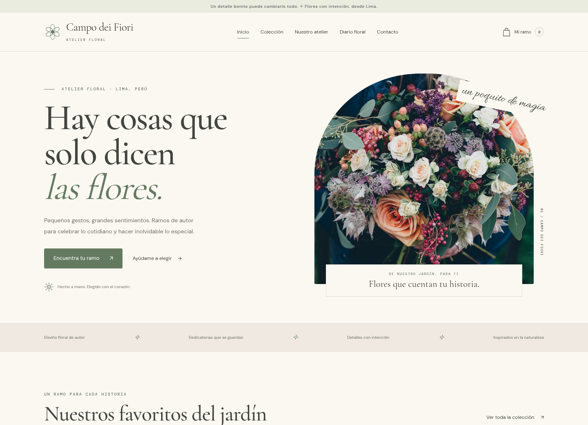

# Campo dei Fiori · Atelier floral

Proyecto académico de **Taller de programación web**. Una florería de autor con fondo blanco crema, rosa empolvado, botones verde salvia y texto gris carbón. Incluye las funciones de Prueba2 con contenido, diseño e historia nuevos.

**Integrantes:** Muña Huaynates Ruth Mirtha y Mori Urbina Robert Augusto.



## Documentos de la entrega

- [Informe del avance 3 en Word](docs/Campo_dei_Fiori_Avance_3.docx)
- [Informe del avance 3 en PDF](docs/Campo_dei_Fiori_Avance_3.pdf)
- [Presentación editable de Campo dei Fiori](docs/Campo_dei_Fiori_Presentacion.pptx)
- [Presentación en PDF](docs/Campo_dei_Fiori_Presentacion.pdf)
- [Evidencias y resultados de validación](docs/evidencias/)

La presentación incluye notas para la exposición. Los documentos explican las funciones implementadas y su relación con los capítulos 3 y 4 del curso. La carátula del informe conserva campos editables para carrera, docente, sección y sede.

## Abrir la web

No requiere instalar paquetes, crear cuentas ni configurar contraseñas.

1. Extrae el ZIP completo y conserva las carpetas `assets` y `js` junto a los HTML.
2. Abre `index.html` con un navegador moderno.
3. Para una demostración más consistente del almacenamiento entre páginas, usa un servidor local. Desde esta carpeta ejecuta:

```bash
python3 -m http.server 8000 --bind 0.0.0.0
```

En Windows también puedes usar `py -m http.server 8000`. Abre el puerto 8000 con tu navegador. Otra opción es Live Server de VS Code. Para detener Python, pulsa Ctrl+C en su terminal. No es necesario ejecutar npm ni compilar.

## Páginas y funciones

- **Inicio:** presentación, favoritos, test floral y acceso al atelier.
- **Colección:** seis ramos generados desde un arreglo, filtro por intención, búsqueda sin distinguir tildes, orden por precio y detalle flotante.
- **Nuestro atelier:** historia original de la marca, misión, visión y valores.
- **Diario floral:** video local de 15 segundos con subtítulos, consejos y preguntas desplegables.
- **Contacto:** sugerencias, horario propuesto y mapa referencial de Barranco.
- **Libro de reclamaciones:** datos del consumidor, producto/servicio, reclamo/queja y solicitud de solución; DNI de 8 dígitos o CE de 9–12 caracteres.
- **Carrito:** añadir, cambiar cantidad (máximo 20 unidades por producto), quitar, subtotal y persistencia local.
- **Pedido de prueba:** recojo gratuito o entrega simulada de S/ 15 a Barranco, Miraflores, Surco o San Borja; fecha desde mañana; dedicatoria de hasta 180 caracteres con vista previa; código de pedido e historial.
- **Test floral:** tres preguntas (intención, paleta y presupuesto) que recomiendan un ramo del catálogo dentro del presupuesto.
- **Privacidad:** historial y constancias eliminables con confirmación. No se conserva información personal.

## Qué se guarda

`localStorage` utiliza las claves `cf-cart-v1`, `cf-orders-v1` y `cf-receipts-v1`. Guarda identificadores y cantidades de ramos, códigos de pedidos, método y fecha simulada de entrega y constancias de formularios. Conserva los últimos 30 pedidos y 30 constancias. **No almacena nombre, correo, teléfono, documento, dirección, mensaje de sugerencia/reclamo ni dedicatoria.** Los registros solo se comparten entre páginas del mismo origen en el mismo navegador. Al abrir archivos directamente, el comportamiento de `localStorage` depende del navegador; se recomienda el servidor local. Si no está disponible, se avisa y se usa memoria temporal.

Para borrar lo guardado: pie de página → **Mis pedidos de prueba** → **Borrar mis datos de prueba** → confirmar. Solo se eliminan las tres claves de este proyecto.

## Estructura y MVC

```text
index.html                  Inicio
coleccion.html              Catálogo
nosotros.html               Identidad del negocio
experiencia.html            Multimedia, cuidados y preguntas
contacto.html               Sugerencias y ubicación
reclamaciones.html           Libro de reclamaciones de prueba
style.css                   Paleta, cuatro fuentes, Grid/Flex y media queries
js/model.js                 Modelo: datos, reglas, carrito y almacenamiento
js/view.js                  Vista: renderizado de componentes compartidos
js/controller.js            Controlador: eventos y coordinación de la interfaz
assets/images/              Fotografías locales
assets/fonts/               Cormorant Garamond, DM Sans, Allura y DM Mono
assets/video/               MP4, cartel y subtítulos VTT
assets/CREDITOS.md           Procedencia y licencias de recursos
```

Son páginas HTML conectadas con una organización MVC en el navegador. El servidor Python sirve archivos estáticos: **no existe un backend de ventas**. Los scripts clásicos permiten abrir los archivos sin módulos ni herramientas de construcción. El CSS emplea Flexbox y Grid en varias páginas, transiciones, animaciones de entrada y respeto a `prefers-reduced-motion`. Los diálogos nativos admiten teclado y Escape.

## Alcance académico

El nombre comercial, la historia y los precios forman parte de un caso ficticio. No hay pagos, ventas, cuentas, autenticación, administración de inventario ni coordinación de entregas reales. El libro es una simulación y no constituye un libro oficial. El mapa requiere Internet y señala el distrito, no un local verificado. Las imágenes, fuentes y video se incluyen localmente; revisa `assets/CREDITOS.md` antes de un uso comercial. El video es un montaje editorial sin audio de las imágenes del proyecto, no un registro de producción real.

## Recorrido sugerido para la sustentación

1. Inicio y navegación; comparar escritorio y móvil.
2. Colección: filtrar, buscar y ordenar; explicar arreglo de objetos y DOM.
3. Test floral: las tres respuestas modifican la recomendación.
4. Añadir dos ramos, cambiar una cantidad, recargar y demostrar persistencia.
5. Carrito: elegir entrega, fecha y dedicatoria; generar pedido de prueba.
6. Abrir historial; explicar los límites de `localStorage` y borrar la demostración.
7. Diario, sugerencias y libro: demostrar validación antes de guardar una constancia.
8. Mostrar las tres capas JS y su relación con las vistas HTML.

Las pruebas y capturas de la entrega documentan resultados concretos; la compatibilidad con otros navegadores requiere una comprobación independiente.
